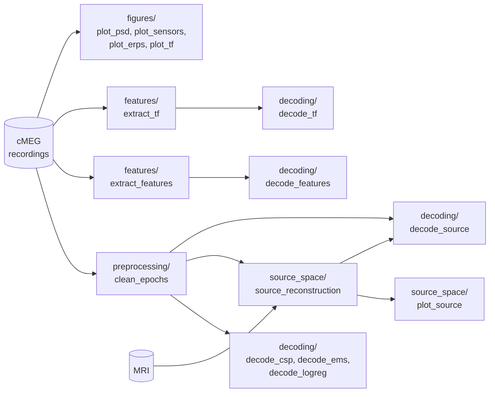

# opm-rps

Decoding rock-paper-scissors hand gestures from optically pumped magnetometer (OPM)
MEG data: one participant (subject 11766), four runs recorded on 2023-06-23 with
triaxial OPMs. Every trial starts with a cue at t = 0 telling the participant which
gesture to make (`roc`, `pap`, `sci`).

## Setup

```bash
uv sync                  # core dependencies
uv sync --extra sweep    # + Weights & Biases hyperparameter sweeps
uv sync --extra viz3d    # + 3D brain plots for the source-space scripts
```

Tell the code where the data lives in a `.env` file at the repository root:

```bash
# Folder containing "Rock Paper Scissors/" (raw cMEG data) and "MRI/" (FreeSurfer)
OPM_RPS_DATA_DIR=/path/to/data/Gesture/Nottingham

# Optional
# OPM_RPS_DERIVATIVES_DIR=/path/to/derivatives  # default: ./derivatives
# OPM_RPS_CONFIG=/path/to/other_config.yaml     # default: ./config.yaml
```

Expected layout of the data folder:

```
$OPM_RPS_DATA_DIR/
├── Rock Paper Scissors/cmeg_data/OPM/20230623/
│   └── 20230623_<HHMMSS>_cMEG_Data/20230623_<HHMMSS>_meg.cMEG  (+ .json/.tsv sidecars)
└── MRI/Segmentation/11766/                                   (FreeSurfer subject)
```

## Repository layout

```
config.yaml           analysis parameters, bad channels and bad trials
src/opm_rps/          shared code, imported by the scripts
  config.py           reads config.yaml and .env; defines every file path
  io.py               .cMEG reader -> MNE Raw + events
  preprocessing.py    bad channels, HFC, notch, cropping, epoching, FIR band-pass
  features.py         variance, band power and Welch power features
  time_frequency.py   Morlet wavelet power and inter-trial phase coherence
  decoding.py         cross-validation, sweeps, embeddings, confusion matrices
  viz.py              plotting style, parula colormap, TF grid, topomaps
scripts/              the analysis steps (see below)
tests/                pytest suite on synthetic recordings
derivatives/          outputs of the scripts (git-ignored, except features.npz)
```

## Pipeline



| Script (`scripts/...`) | Reads | Writes (`derivatives/...`) |
| --- | --- | --- |
| `preprocessing/clean_epochs.py` | raw runs 1-4 | `epochs/all_runs-filt_7_30-epo.fif.gz` |
| `features/extract_features.py` | raw runs 2-4 | `features/features.npz` |
| `features/extract_tf.py` | raw runs 1-4 | `tf/tf-<run>-<axis>.npz` |
| `decoding/decode_csp.py` | cleaned epochs | (scores, embeddings) |
| `decoding/decode_ems.py` | cleaned epochs | (EMS surrogates, filters, scores) |
| `decoding/decode_logreg.py` | cleaned epochs | (pattern and filter topomaps) |
| `decoding/decode_features.py` | `features.npz` | (PCA/LDA/UMAP + SVM results) |
| `decoding/decode_tf.py` | `tf/*.npz` | (UMAP + SVM results) |
| `decoding/decode_source.py` | cleaned epochs, inverse operator | `figures/decoding/` |
| `source_space/source_reconstruction.py` | cleaned epochs, MRI | `source/`, `reports/source_space.html` |
| `source_space/plot_source.py` | `source/` | `figures/source/`, `reports/source_estimate.html` |
| `figures/plot_psd.py` | raw runs 1-4 | `figures/psd/` |
| `figures/plot_sensors.py` | raw run 1 | `figures/sensors/` |
| `figures/plot_erps.py` | raw runs 1-4 | `figures/erp/` |
| `figures/plot_tf.py` | raw runs 1-4 | `figures/tf/` |

Run a script with `uv run python scripts/<step>/<script>.py`, or open it in VS Code
and run it cell by cell (`# %%`). When editing `src/opm_rps` during an interactive
session, enable `%autoreload 2`.

### Preprocessing at a glance

Every analysis marks the bad channels (`bad_channels` in `config.yaml` plus those
flagged "Bad" in the recording's channels.tsv), applies homogeneous field correction
(HFC, order 2) and crops run 3 at 681 s, where run 4 begins. Beyond that:

| Used by | Runs | Filtering | Epochs (-0.5 to 2.1 s) | Rejected trials |
| --- | --- | --- | --- | --- |
| ERP, TF and PSD figures, TF features | 1-4, separately | none | linear detrend | `bad_epochs` (per run) |
| Decoding epochs, source space | 1-4, concatenated | least-squares FIR 7-30 Hz | linear detrend, baseline -0.5 to 0 s | `bad_epoch_indices` |
| Feature matrices | 2-4, concatenated | notch + 1-400 Hz | none | none |

## Known caveats of the analysis

- **No MEG-MRI coregistration**: the source space uses the identity transform, so
  source estimates are not anatomically aligned (hence "misaligned" in file names).
- The noise covariance of the inverse operator is estimated from the whole epochs,
  not only the pre-cue baseline.
- Welch spectra of the band-power features use `n_fft=256` (~4.7 Hz resolution), so
  the delta, theta and alpha band powers are always zero.
- The wavelet convolution treats the trials of a condition as one concatenated
  signal, so the edges of each trial (including the dB baseline at -0.45 to -0.15 s)
  are mixed with the neighbouring trials at low frequencies.
- `bad_epochs` and `bad_epoch_indices` are two independent annotations of bad
  trials, made for different analyses.
- The committed `derivatives/features/features.npz` predates the current feature
  script: it was computed on 2023-09-19 from runs 1-4 (720 trials, no trials
  rejected) with an earlier list of 22 bad channels. Run 1 was left out of the
  script in 2024. Running `features/extract_features.py` replaces the file.

## Tests

```bash
uv run pytest
```

The tests generate synthetic recordings in the cMEG format (`tests/synthetic.py`);
no real data is needed.
