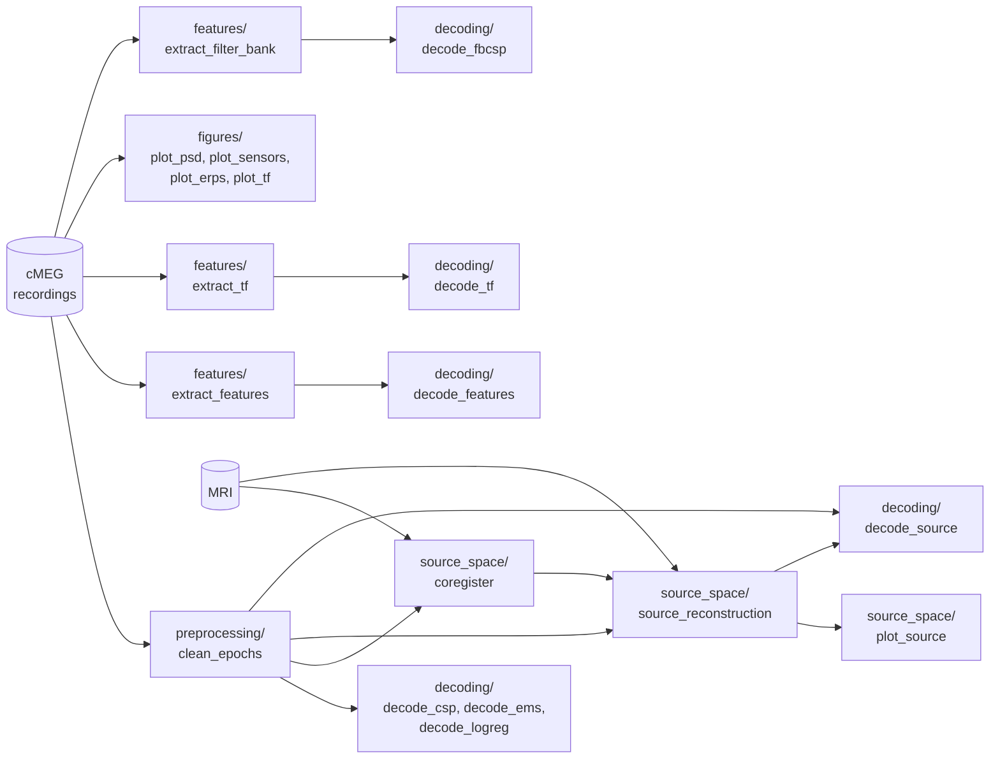

# opm-rps

Decoding rock-paper-scissors hand gestures from optically pumped magnetometer (OPM)
MEG data: one participant (subject 11766), four runs recorded on 2023-06-23 with
triaxial OPMs. Every trial starts with a cue at t = 0 telling the participant which
gesture to make (`roc`, `pap`, `sci`).

## Setup

```bash
uv sync                  # core dependencies
uv sync --extra sweep    # + Weights & Biases hyperparameter sweeps
uv sync --extra viz3d    # + 3D brain plots and MRI headers for the source space
```

Tell the code where the data lives in a `.env` file at the repository root:

```bash
# Dataset folder containing "20230623/" (raw cMEG data) and "MRI/" (FreeSurfer)
OPM_RPS_DATA_DIR=/path/to/opm-data/2023-06-21_nottingham

# Optional
# OPM_RPS_DERIVATIVES_DIR=/path/to/derivatives  # default: ./derivatives
# OPM_RPS_CONFIG=/path/to/other_config.yaml     # default: ./config.yaml
```

Expected layout of the data folder:

```
$OPM_RPS_DATA_DIR/
├── 20230623/
│   └── 20230623_<HHMMSS>_cMEG_Data/20230623_<HHMMSS>_meg.cMEG  (+ .json/.tsv sidecars)
└── MRI/Segmentation/11766/                                   (FreeSurfer subject)
```

## Repository layout

```
config.yaml           analysis parameters, bad channels and bad trials
src/opm_rps/          shared code, imported by the scripts
  config.py           reads config.yaml and .env; defines every file path
  io.py               .cMEG reader -> MNE Raw + events
  preprocessing.py    bad channels/trials, HFC, notch, cropping, epoching, filters
  features.py         variance, band power and Welch power features, filter bank bands
  time_frequency.py   Morlet wavelet power and inter-trial phase coherence
  coregistration.py   MEG-MRI coregistration and sensor-to-scalp distances
  decoding.py         cross-validation, sweeps, embeddings, confusion matrices
  csp.py              CSP and filter bank CSP (scikit-learn transformers)
  classification.py   CSP pipelines, hold-out evaluation, chance level, cross-run tables
  viz.py              plotting style, parula colormap, TF grid, topomaps, accuracies
scripts/              the analysis steps (see below)
tests/                pytest suite on synthetic recordings
derivatives/          outputs of the scripts (git-ignored, except features.npz)
```

## Pipeline



| Script (`scripts/...`) | Reads | Writes (`derivatives/...`) |
| --- | --- | --- |
| `preprocessing/clean_epochs.py` | raw runs 1-4 | `epochs/all_runs-filt_7_30-epo.fif.gz` |
| `features/extract_features.py` | raw runs 2-4 | `features/features.npz` |
| `features/extract_tf.py` | raw runs 1-4 | `tf/tf-<run>-<axis>.npz` |
| `features/extract_filter_bank.py` | raw runs 1-4 | `features/filter_bank.npz` |
| `decoding/decode_csp.py` | cleaned epochs | (scores, embeddings) |
| `decoding/decode_ems.py` | cleaned epochs | (EMS surrogates, filters, scores) |
| `decoding/decode_logreg.py` | cleaned epochs | (pattern and filter topomaps) |
| `decoding/decode_features.py` | `features.npz` | (PCA/LDA/UMAP + SVM results) |
| `decoding/decode_tf.py` | `tf/*.npz` | (UMAP + SVM results) |
| `decoding/decode_fbcsp.py` | `filter_bank.npz` | `figures/fbcsp/` |
| `decoding/decode_source.py` | cleaned epochs, inverse operator | `figures/decoding/` |
| `source_space/coregister.py` | cleaned epochs, SensorTransform sidecars, MRI | `source/<subject>-trans.fif`, `figures/source/`, `reports/coregistration.html` |
| `source_space/source_reconstruction.py` | cleaned epochs, MRI, `source/<subject>-trans.fif` | `source/`, `reports/source_space.html` |
| `source_space/plot_source.py` | `source/` | `figures/source/`, `reports/source_estimate.html` |
| `figures/plot_psd.py` | raw runs 1-4 | `figures/psd/` |
| `figures/plot_sensors.py` | raw run 1 | `figures/sensors/` |
| `figures/plot_erps.py` | raw runs 1-4 | `figures/erp/` |
| `figures/plot_tf.py` | raw runs 1-4 | `figures/tf/` |

Run a script with `uv run python scripts/<step>/<script>.py`, or open it in VS Code
and run it cell by cell (`# %%`). When editing `src/opm_rps` during an interactive
session, enable `%autoreload 2`.

Run the scripts one at a time. On the real data, the preprocessing, figure and
decoding scripts each need up to about 17 GB of memory, and an interactive window
keeps its data until its kernel is restarted.

### Preprocessing at a glance

Every analysis marks the bad channels (`bad_channels` in `config.yaml` plus those
flagged "Bad" in the recording's channels.tsv), applies homogeneous field correction
(HFC, order 2) and crops run 3 at 681 s, where run 4 begins. Every trial-level
analysis rejects the same trials: the union of the two bad-trial annotations in
`config.yaml`, `bad_epochs` (the cue sample of each rejected trial, per run) and
`bad_epoch_indices` (positions into the cue events of runs 1-4, per sensor axis);
see `opm_rps.preprocessing.bad_trials`. Both annotations mark the same 122 of the
720 trials (73, 18, 17 and 14 in runs 1-4). Beyond that:

| Used by | Runs | Filtering | Epochs (-0.5 to 2.1 s) |
| --- | --- | --- | --- |
| ERP, TF and PSD figures, TF features | 1-4, separately | none | linear detrend |
| Decoding epochs, source space | 1-4, concatenated | least-squares FIR 7-30 Hz | linear detrend, baseline -0.5 to 0 s |
| Feature matrices | 2-4, concatenated | notch + 1-400 Hz | none |
| Filter bank CSP | 1-4, separately | FIR 7-30 Hz and ten 4 Hz bands within it | none, decimated to 150 Hz |

The time-frequency figures and features are computed on epochs extended by a buffer
of recorded data on both sides of -0.5 to 2.1 s: three Gaussian widths of the
lowest-frequency wavelet, 1.91 s for `plot_tf.py` (1-40 Hz) and 0.95 s for
`extract_tf.py` (2-50 Hz). Each trial is convolved separately with the wavelets and
the result is cropped to -0.5 to 2.1 s before the dB baseline normalisation, so
within the window the wavelets never reach past the recorded data. Trials whose
buffered epoch does not fit into the recording (or the crop of run 3) are dropped;
the linear detrend is fitted to the buffered epochs.

The band-power and total-power features come from Welch spectra with a resolution
of 1 Hz (1-s Hamming windows overlapping by half).

### CSP and filter bank CSP

`decode_fbcsp.py` applies the motor imagery classification of the bachelor's thesis
project eeg-eog-hybrid-unicorn to the gestures. `opm_rps.csp` and
`opm_rps.classification` are ported from it (at `08cd31d`) and give the same
features and predictions:

- **CSP + LDA**: the log-variances of two CSP filter pairs in the decoding band
  (7-30 Hz) and linear discriminant analysis.
- **SFBCSP + LASSO + SVM**: the sub-band filter bank CSP, one CSP filter pair in
  each of ten 4 Hz bands 2 Hz apart (7-11 Hz to 25-29 Hz), the features with
  non-zero LASSO weights and a support vector machine.

As in the thesis, each model is trained on 70 % of the trials (0.5 to 2 s after the
cue), cross-validated on them (10 folds) and tested on the other 30 %. For this
data:

- CSP compares two classes, so for all three gestures each pipeline learns every
  gesture against the other two (one-vs-rest), and the most confident one wins.
- The split and the folds are stratified by gesture. Chance is the accuracy of
  always predicting the most frequent gesture of the test trials, and each test
  accuracy gets a one-sided binomial p-value against it.
- `extract_filter_bank.py` filters the continuous runs before epoching, as the
  thesis did for the BCI Competition data: the cleaned epochs end 0.1 s after the
  decoding window, so filtering them would leave edge effects in it. The transition
  bands are 2 Hz wide (MNE's default widens them with the cutoff, to 7 Hz at
  29 Hz), and the epochs are decimated to 150 Hz. In 0.5-2 s, its 7-30 Hz band
  correlates at 0.98 with the cleaned epochs.
- If the LASSO keeps no feature, the first one on its path is kept, so the SVM
  still gets an input. On the real data it always kept 10 to 20 of the 20.

Results on the real data, with the trials of all runs. The test accuracies of a
single split vary by several points, so the table gives those of the script's split
(seed 12, with the binomial p-value) and the mean (SD) over 20 random splits:

| Gestures | Test trials | Chance | Above chance from | CSP + LDA | 20 splits | SFBCSP + LASSO + SVM | 20 splits |
| --- | ---: | ---: | ---: | ---: | ---: | ---: | ---: |
| Rock vs paper | 120 | 51 % | 59 % | 61 % (p = 0.018) | 57 (5) % | 53 % (p = 0.32) | 53 (4) % |
| Rock vs scissors | 119 | 50 % | 59 % | 70 % (p = 1.5e-5) | 62 (5) % | 65 % (p = 0.0012) | 57 (4) % |
| Paper vs scissors | 120 | 51 % | 59 % | 63 % (p = 0.0066) | 57 (4) % | 56 % (p = 0.16) | 54 (3) % |
| All three | 180 | 34 % | 41 % | 48 % (p = 4.4e-5) | 42 (3) % | 47 % (p = 2.6e-4) | 39 (3) % |

- **The script's split is favourable.** Its CSP + LDA accuracies lie 4 to 8 points
  (0.9 to 2 SD) above the mean over 20 splits. Over the splits, the validation and
  test accuracies agree (all three: 41.7 and 42.1 %).
- **CSP + LDA decodes the gestures above chance.** Cross-validated on all trials (10
  folds), it reaches 41.1 % for all three gestures and 62.6 % for rock vs scissors.
  That beats every one of 200 shufflings of the labels (33.0 ± 2.8 % and
  49.9 ± 3.6 %), giving p = 0.005, the smallest possible.
- **The filter bank does not help.** SFBCSP + LASSO + SVM stays 3 to 5 points below
  CSP + LDA. Its LASSO keeps 10 to 20 of the 20 features (median 15), spread over all
  bands (`figures/fbcsp/lasso_weights.png`).
- **Single runs have too few trials.** With 33 to 50 test trials, a run's accuracy is
  only above chance from 48 to 52 %. None of the 8 accuracies reaches p < 0.05 (the
  closest is p = 0.051), and the cross-run tables stay between 24 and 48 %.
- **Controls.**
  - Before the cue (`TIME_WINDOW = (-0.5, 0)`, 5 splits), both pipelines are at
    chance: 31 to 35 % for all three gestures and 50 to 51 % for rock vs scissors.
  - With shuffled labels they are at chance too (34 ± 4 %).
  - The gestures are balanced within each run, so the run cannot give them away:
    always guessing a run's most frequent gesture gets 31 %.

### Source space

The sensor positions come from the HelmConfig sidecar. Subject 11766 wore a helmet
designed on the MRI, so the positions are already in the scanner RAS frame of the
MRI: the SensorTransform sidecars are the identity and the MRI's `c_ras` is 0.
`source_space/coregister.py` writes the head -> MRI transform (`coregistration:
scanner_ras` in `config.yaml`) and checks it with the sensor-to-scalp distances
(5-24 mm, none inside the head) and a 3D view in `reports/coregistration.html`.
`coregistration: identity` skips the coregistration; the files are then labelled
"misaligned".

The noise covariance of the inverse operator is estimated from the pre-cue baseline
(-0.5 to 0 s) of the cleaned epochs; its rank is reduced by the 8 HFC projectors.

## Known caveats of the analysis

- The feature matrices leave out run 1, as the original feature script did from
  2024 on; no reason was recorded. Add `'run_1'` to `RUNS` in
  `features/extract_features.py` to include its 107 good trials.
- The test accuracies of `decode_fbcsp.py` come from a single split of the trials
  (seed 12), and a favourable one: averaged over 20 splits, they are 4 to 8 points
  lower (see [CSP and filter bank CSP](#csp-and-filter-bank-csp)).

## Tests

```bash
uv run pytest
```

The tests generate synthetic recordings in the cMEG format (`tests/synthetic.py`);
no real data is needed. The coregistration tests need nibabel (`viz3d` extra) and are
skipped without it.
